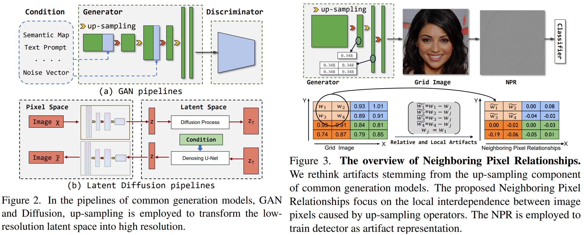

# Deepfake Detection with NPR

Extending the CVPR 2024 NPR detector (Neighboring Pixel Relationships) with a learnable AdaptiveNPR module, a spatial-frequency hybrid branch, an upgraded training recipe, an evaluation toolkit and a Gradio demo.


<p align="center">
  
  <br>
  <em>Overview figure from the original NPR paper (Tan et al., CVPR 2024).</em>
</p>

This repository is a scientific research project on detecting AI-generated images with CNNs. Models are evaluated with **Accuracy, AUC and False Positive Rate (FPR)**, together with AP and per-class (real / fake) accuracy. It is built on top of the official implementation of
[*Rethinking the Up-Sampling Operations in CNN-based Generative Network for Generalizable Deepfake Detection*](https://arxiv.org/abs/2312.10461) (CVPR 2024). Full credit for the NPR idea and the base code goes to the original authors (see [Acknowledgements](#-acknowledgements--citation)).

> A companion repository, [`Deepfake-Detect-baseline`](https://github.com/KimThanhTran/Deepfake-Detect-baseline), compares a plain RGB ResNet-50 baseline, NPR and a hybrid spatial-frequency model under one training pipeline.

## 📌 Overview

NPR observes that the up-sampling layers of generative networks leave local correlations between neighboring pixels. The detector feeds the residual `x - up(down(x))` into a ResNet-style classifier, which lets it generalize across GAN and diffusion generators.

### What is new compared with the original repository

Everything below is implemented in this repository's code:

| Area | Addition | Where |
|---|---|---|
| Architecture | **AdaptiveNPR**: a learnable, multi-scale (x2, x4) NPR residual with depthwise convolutions and a gating branch, used instead of the fixed residual | `networks/adaptive_npr.py`, `--adaptive_npr` |
| Architecture | **Hybrid spatial-frequency detector**: frozen NPR spatial branch (512-d features) + a small CNN over the FFT log-magnitude spectrum (256-d), fused by an MLP head; only the frequency branch and the head are trained | `networks/frequency_branch.py`, `train_frequency.py` |
| Training | Mixed precision, label smoothing, cosine LR decay, initialization from a pretrained checkpoint, fixed seed, optional blur/JPEG augmentation | `train.py`, `options/train_options.py` |
| GenImage | Optional "translate-and-duplicate" input transform (`--genimage_mode`) | `options/base_options.py` |
| Checkpoint loading | `build_npr_model()` auto-detects AdaptiveNPR checkpoints and loads them strictly | `util.py` |
| Evaluation | Per-subset Accuracy / AP / ROC-AUC / precision / recall / F1 / balanced accuracy / **FPR** / MCC with confusion-matrix figures; score-level fusion of two models | `tools/eval_report.py`, `tools/fuse_scores.py`, `tools/augment_metrics.py` |
| Visualization | Real-vs-fake frequency-spectrum plots | `visualize_frequency.py` |
| Demo | Gradio apps (single image, batch + CSV export, CSV comparison) and a Docker setup | `gradio_ui.py`, `app/gradio_app.py`, `Dockerfile`, `docker-compose.yml` |
| Reproducibility | Kaggle GPU notebooks for the hybrid model and the augmentation / AdaptiveNPR experiments | `kaggle/*.ipynb` |

## 📊 Results

Numbers below are copied from the repository's own result files. They come from a 30-epoch fine-tuning run on ForenSynths (Kaggle P100, Adam, lr 1e-4, batch size 32, cosine LR, label smoothing 0.05, mixed precision, as listed in `TOTAL_RESULTS.csv`). The fine-tuned checkpoint itself is **not** included in the repository.

**Cross-dataset results** (source: `TOTAL_RESULTS.csv`, also `comprehensive_results.csv`)

| Dataset | Samples | Accuracy | AP | ROC-AUC | Real Acc | Fake Acc | FPR* |
|---|---:|---:|---:|---:|---:|---:|---:|
| ForenSynths val (in-domain) | 1,600 | 100.00% | 100.00% | 100.00% | 100.00% | 100.00% | 0.00% |
| UniversalFakeDetect | 16,000 | 91.84% | 97.36% | 97.53% | 94.01% | 89.68% | 5.99% |
| GANGen-Detection | 36,000 | 64.37% | 73.61% | 78.54% | 32.96% | 95.77% | 67.04% |

\* FPR is derived as `100% - Real Acc` (real images wrongly flagged as fake).
Mean accuracy over these three sets: 85.40% (`TOTAL_RESULTS.csv`). These figures come from an earlier run and are preliminary: the checkpoint is not published and the numbers have not been re-verified after later bug fixes to the training code.

**Per-generator accuracy on the ForenSynths 8-GAN test sets**, final epoch (source: `training_progress.csv`, AP from `results_comparison.csv`)

| ProGAN | StyleGAN | StyleGAN2 | BigGAN | CycleGAN | StarGAN | GauGAN | DeepFake | Mean |
|---:|---:|---:|---:|---:|---:|---:|---:|---:|
| 99.6 | 96.2 | 97.2 | 84.2 | 85.9 | 99.7 | 80.2 | 68.1 | **88.9** (AP 92.8) |

**Reading the results.** The model separates ForenSynths and UniversalFakeDetect well, but on GANGen-Detection it labels most real images as fake (Real Acc 32.96%, i.e. a high FPR). The report files list this, DeepFake and GauGAN as the main weaknesses.

The hybrid spatial-frequency model and the AdaptiveNPR / augmentation experiments are implemented and scripted (`train_frequency.py`, `kaggle/`), but **no result tables for them are stored in this repository**.

## 📁 Project structure

```
.
├── train.py                   # NPR training (AdaptiveNPR / AMP / label smoothing / cosine LR)
├── train_frequency.py         # hybrid spatial-frequency training
├── evaluate_hybrid.py         # hybrid evaluation (+ comparison with a spatial-only model)
├── evaluate_all_datasets.py   # evaluate a trained model on the local benchmark folders
├── visualize_frequency.py     # frequency-spectrum visualization
├── validate.py, util.py       # validation loop, checkpoint helpers
├── gradio_ui.py               # Gradio demo (baseline vs fine-tuned model)
├── app/gradio_app.py          # Gradio demo (single / batch / CSV compare)
├── networks/                  # resnet.py (NPR), adaptive_npr.py, frequency_branch.py, hsf_model.py
├── options/                   # command-line options
├── data/                      # dataset + dataloader (blur/JPEG augmentation)
├── tools/                     # eval_report.py, fuse_scores.py, summarize / plotting / export scripts
├── kaggle/                    # Kaggle training notebooks
├── weights/NPR.pth            # pretrained NPR checkpoint
├── Dockerfile, docker-compose.yml
├── TOTAL_RESULTS.csv / .md    # consolidated results
└── FINAL_REPORT.md, CONTRIBUTION_SUMMARY.md, IMPLEMENTATION_SUMMARY.md, FREQUENCY_BRANCH_GUIDE.md
```

## ⚙️ Installation

```bash
git clone https://github.com/KimThanhTran/Deepfake-Detect.git
cd Deepfake-Detect

python -m venv .venv
# Windows: .venv\Scripts\activate      Linux/macOS: source .venv/bin/activate
pip install -r requirements.txt
pip install matplotlib tqdm tensorboard   # used by tools/, train_frequency.py and training logs
```

For a CUDA build of PyTorch, install it from the [PyTorch index](https://pytorch.org/get-started/locally/) first (the project's previous notes used `torch==2.2.2 torchvision==0.17.2` with the `cu121` index). The code falls back to CPU when CUDA is unavailable.

## 🚀 Usage

### Train

Training data must follow `<dataroot>/train/<class>/{0_real,1_fake}`, with `val/` and `test/` next to it (see [Dataset notes](#-dataset-notes)).

```bash
# Original NPR recipe
python train.py --name npr_run --dataroot ./dataset/ForenSynths \
    --classes car,cat,chair,horse --batch_size 32 --lr 0.0002 --niter 50

# With this repository's improvements
python train.py --name npr_adaptive --dataroot ./dataset/ForenSynths \
    --classes car,cat,chair,horse --batch_size 32 --lr 0.0002 --niter 50 \
    --adaptive_npr --use_amp --label_smoothing 0.05 --cosine_lr
```

Useful flags: `--pretrained_path`, `--seed`, `--blur_prob` / `--jpg_prob` (augmentation), `--genimage_mode`, `--skip_bench_eval` (skip the per-epoch 8-GAN test, which otherwise requires `<dataroot>/test/{progan,stylegan,...}`). Checkpoints are written to `checkpoints/<name>_<timestamp>/` (`model_epoch_last.pth`).

Hybrid spatial-frequency model (frozen NPR spatial branch):

```bash
python train_frequency.py --spatial_model_path weights/NPR.pth \
    --dataroot dataset/ForenSynths --batch_size 32 --epochs 10 --lr 0.001
```

### Evaluate

```bash
python tools/eval_report.py --model_path weights/NPR.pth \
    --dataroot dataset/ForenSynths/test --out_dir results/npr \
    --subsets progan stylegan stylegan2 biggan cyclegan stargan gaugan deepfake
```

This writes `metrics.csv` (Accuracy, AP, AUC, precision, recall, F1, balanced accuracy, FPR, MCC per subset plus a mean row) and `confusion_matrices.png`.
Add `--arch hybrid --spatial_model_path weights/NPR.pth` for a hybrid checkpoint, `--save_scores` to dump per-image scores, and use `tools/fuse_scores.py` to fuse two saved runs.

```bash
python evaluate_hybrid.py --hybrid_model_path checkpoints/hybrid_frequency_<timestamp>/model_best.pth \
    --baseline_model_path <spatial_only_checkpoint.pth> --compare_baseline
python visualize_frequency.py --mode auto
```

### Demo (Gradio)

```bash
python gradio_ui.py          # http://127.0.0.1:7860
```

`gradio_ui.py` loads `NPR.pth` and a fine-tuned checkpoint; set the paths with the `NPR_BASELINE_PATH` and `NPR_TRAINED_PATH` environment variables. `python app/gradio_app.py` provides single-image prediction, batch prediction with CSV download and a CSV-comparison tab.

### Docker

```bash
# Put weights in ./weights (NPR.pth is included), then:
docker compose up --build -d          # Gradio UI on http://localhost:7860

# CPU training profile
docker compose --profile train run --rm train \
    python train.py --name my_run --dataroot dataset/ForenSynths \
    --batch_size 32 --niter 10 --num_threads 8 --skip_bench_eval
```

The image installs the CPU build of PyTorch; the `Dockerfile` comments explain how to switch to CUDA.

## 🗂 Dataset notes

Datasets are **not** included. Download scripts: `download_dataset.sh` (uses `gdown`) and `download_dataset.ps1`. Expected layout:

```
dataset/ForenSynths/
├── train/{car,cat,chair,horse}/{0_real,1_fake}
├── val/{car,cat,chair,horse}/{0_real,1_fake}
└── test/{progan,stylegan,stylegan2,biggan,cyclegan,stargan,gaugan,deepfake}
```

- Training / validation: ForenSynths (CNNDetection, Wang et al., CVPR 2020). The reports list 144,024 training images (4 classes) and 1,600 validation images.
- Generalization benchmarks used in the reports and scripts: GANGen-Detection, UniversalFakeDetect, DiffusionForensics, Diffusion1kStep (links in the [original NPR repository](https://github.com/chuangchuangtan/NPR-DeepfakeDetection)).

## 🙏 Acknowledgements & Citation

This project builds on the official [NPR-DeepfakeDetection](https://github.com/chuangchuangtan/NPR-DeepfakeDetection) code by Chuangchuang Tan et al. (Beijing Jiaotong University, YanShan University, A*STAR) and partially borrows from [CNNDetection](https://github.com/peterwang512/CNNDetection) (Wang et al., CVPR 2020). Please cite the original paper if you use this work:

```bibtex
@inproceedings{tan2024rethinking,
  title     = {Rethinking the Up-Sampling Operations in CNN-based Generative Network for Generalizable Deepfake Detection},
  author    = {Tan, Chuangchuang and Liu, Huan and Zhao, Yao and Wei, Shikui and Gu, Guanghua and Liu, Ping and Wei, Yunchao},
  booktitle = {Proceedings of the IEEE/CVF Conference on Computer Vision and Pattern Recognition (CVPR)},
  year      = {2024},
  eprint    = {2312.10461},
  archivePrefix = {arXiv}
}

@inproceedings{wang2019cnngenerated,
  title     = {CNN-generated images are surprisingly easy to spot... for now},
  author    = {Wang, Sheng-Yu and Wang, Oliver and Zhang, Richard and Owens, Andrew and Efros, Alexei A},
  booktitle = {CVPR},
  year      = {2020}
}
```

Inherited code keeps the licensing terms of its sources (CNNDetection is released under CC BY-NC-SA 4.0, as noted in the original README); this repository does not add a license file of its own.

**Author:** Trần Thị Kim Thanh ([@KimThanhTran](https://github.com/KimThanhTran)), final-year Software Engineering student at HUTECH, as part of a scientific research project on deepfake detection.
